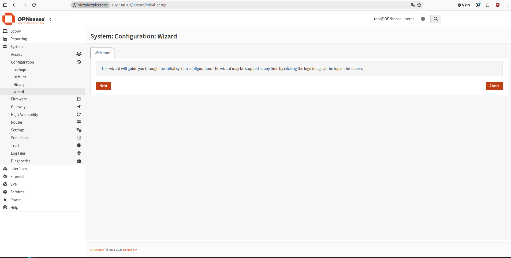
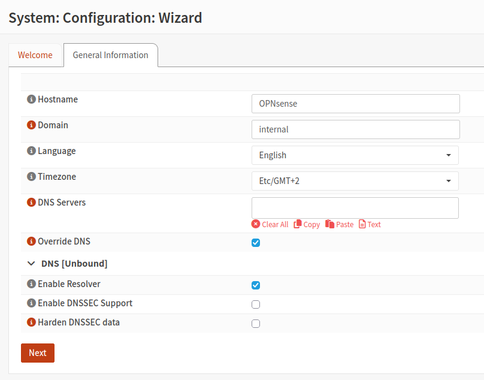
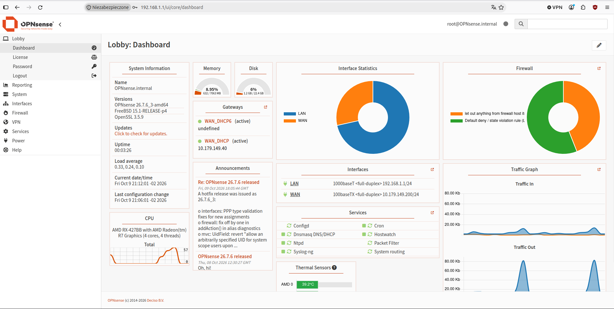
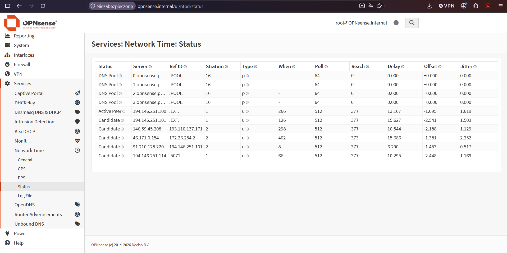

# 01 - Instalacja i konfiguracja początkowa

## Cel

Zainstalowanie i przygotowanie do użycia platformy OPNsense.

## Środowisko

- System: OPNsense 26.7
- Urządzenie: HP t730 Thin Client
- Punkt startowy:
    - Urządzenie z dostępem do internetu i możliwością przygotowania nośnika instalacyjnego (laptop z systemem Linux Mint),
    - Urządzenie na którym będzie instalowany OPNsense (HP t730 Thin Client)

## Wykonanie

### 1. Przygotowanie nośnika instalacyjnego

Pobranie ze strony [OPNsense](https://opnsense.org/download/) obrazu instalacyjnego o odpowiednim formacie i stworzenie nośnika:
- vga - obraz przeznaczony do stworzenia instalacyjnego USB dla urządzenia zarządzanego bezpośrednio
- dvd - obraz przeznaczony do stworzenia instalacyjnej płyty DVD lub do wykorzystania w maszynach wirtualnych,
- serial - obraz przeznaczony do stworzenia instalacyjnego USB dla urządzenia zarządzanego poprzez port szeregowy,
- nano - lekki, wstępnie przygotowany obraz systemu zapisywany bezpośrednio na urządzeniu (np. na karcie SD), wykorzystywany w instalacjach embedded.
Jako typ obrazu wybrałem vga, nośnik przygotowałem za pomocą aplikacji USB Image Writer na systemie Linux Mint.

### 2. Pierwsze uruchomienie

Po uruchomieniu nośnika zostaniemy poproszeni o skonfigurowanie LAGG, VLAN oraz przypisanie interfejsów sieciowych (LAGG i VLAN można skonfigurować później w interfejsie graficznym, interfejsy sieciowe mogą zostać przypisane automatycznie). W momencie gdy zostanie wymuszone logowanie, możliwe jest połączenie się poprzez ssh na adres 192.168.1.1. Aby dostać się do instalatora, należy użyć loginu: installer i hasła: opnsense.

### 3. Instalacja

1. Układ klawiatury.
2. Wybór pomiędzy systemem plików ZFS i UFS - ZFS to bardziej zaawansowany system plików oferujący mechanizmy integralności danych, wymaga więcej RAMu i miejsca na dysku, UFS to klasyczny system plików wykorzystywany w BSD. W 90% przypadków ZFS jest odpowiednim wyborem, chyba że podzespoły są naprawdę niedomagające (≤ 2GB RAM, < 32GB SSD/HDD).
3. Partycjonowanie - stripe przy jednym dysku, możliwość skonfigurowania mirroringu i RAIDu przy wielu dyskach. Po wyborze dysku nastąpi formatowanie i instalacja.
4. Zmiana hasła roota (z oczywistych powodów należy to zrobić).

### 4. Konfiguracja wstępna

Po zakończonej instalacji i restarcie urządzenia konfiguracja wstępna przeprowadzana jest w interfejsie graficznym dostępnym pod adresem 192.168.1.1. Po zalogowaniu rozpocznie się konfiguracja. W trakcie konfiguracji ustawiłem nazwę hosta, język, strefę czasową i domenę (ważne żeby domeną nie było .local ze względu na konflikty z mDNS, zostawiłem domyśłne .internal, i żeby wybrać odpowiednią strefę czasową). W późniejszych krokach zezwoliłem również na połączenia z sieci prywatnych na interfejsie WAN, ze względu na to że urządzenie aktualnie znajduje się w sieci prywatnej, wyłączyłem serwer DHCP działający na porcie LAN optymalizację pod Multiwan i automatyczną rejestrację DHCP/DNS, i zostawiłem domyślne ustawienia DNS. Poszczególne funckje i usługi będą konfigurowane w późniejszym czasie. Po wstępnej konfiguracji należy zaktualizować system wybierając opcję "check for updates" na ekranie dashboard, a następnie "update".

### 5. Serwer NTP

Istnieje możliwość, że mimo wybrania odpowiedniej strefy czasowej czas systemowy będzie przesunięty o kilka godzin. W moim przypadku winowajcą były domyślne serwery NTP z którymi zapora nie mogła się połączyć. W celu modyfikacji puli serwerów należy przejść do zakładki **Services** > **Network Time** > **General** i dodać adresy. Wykorzystałem serwery udostępnianie przez Główny Urząd Miar: _tempus1.gum.gov.pl_ i _tempus2.gum.gov.pl_. Jeżeli zakładka **Services** > **Network Time** > **Status** pokazuje aktywne połączenie (_Active Peer_, należy poczekać kilka minut), a czas pokazywany przez GUI wciąż jest nieprawidłowy, należy uruchomić ponownie urządzenie.

## Konfiguracja

Interfejs LAN - wbudowany (re0)
Intefejs WLAN - broadcom 0  (bge0)
System plików - ZFS
Serwery NTP - _tempus1.gum.gov.pl_ i _tempus2.gum.gov.pl_

## Test

**Cel testu:** Sprawdzenie łączności interfejsu LAN i możliwości zalogowania się do interfejsu graficznego zapory.

**Polecenie / czynność:**

1. Ustawienie na urządzeniu statycznego adresu sieciowego znajdującego się w tej samej podsieci co adres interfejsu LAN zapory ogniowej. 
2. Wejście poprzez przeglądarkę internetową do interfejsu graficznego znajdującego się pod adresem interfejsu LAN zapory ogniowej (192.168.1.1).

**Oczekiwany wynik:**

GUI dostępne pod adresem 192.168.1.1

**Rzeczywisty wynik:**

GUI dostępne pod adresem 192.168.1.1

## Screenshots

## Rezultat

Bez żadnego problemu udało się zainstalować i wstępnie skonfigurować zaporę ogniową OPNsense.

## Uwagi

W kolejnych krokach należy skonfigurować DNS, DHCP, NAT i zasady zapory ogniowej.

