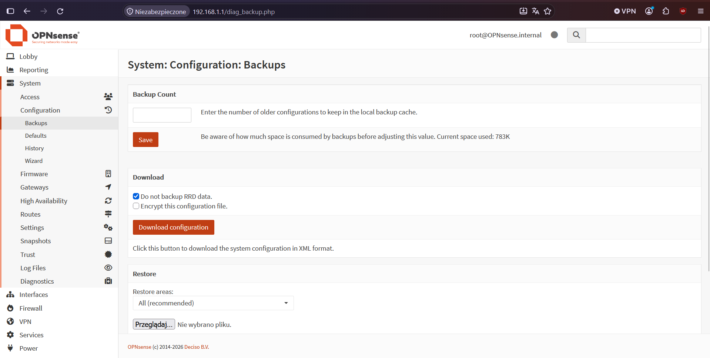
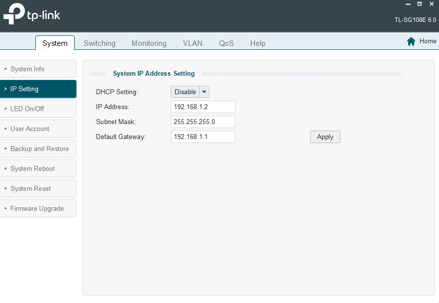

# 02 - Utworzenie i wstępna konfiguracja VLAN

## Cel

Wdrożenie segmentacji sieci VLAN 802.1Q na OPNsense i switchu.

## Środowisko

- System: OPNsense 26.7
- Urządzenie: HP t730 Thin Client, Tp-Link TL-SG108E
- Punkt startowy:
    - GUI OPNsense osiąglane pod statycznym adresem IP
    - Switch podłączony kablem Ethernet do komputera

## Wykonanie

### 1. Wykonanie kopii zapasowej konfiguracji OPNsense

W GUI OPNsesne, w zakładce **System** > **Configuration** > **Backups** mamy możliwość pobrania pliku XML zawierającego konfigurację zapory ogniowej. Narzędzie to pozwala również na zaszyfrowanie pobieranego pliku oraz ominięcia danych RRD (historyczne dane dotyczące stanu systemu i ruchu sieciowego, wraz z wykresami). Ponieważ ten backup będzie przechowywany lokalnie nie będę szyforwał pliku, nie będę również pobierał danych RRD.

### 2. Przygotowanie oprogramowania do konfiguracji switcha

Ze strony wsparcia urządzenia Tp-Link TL-SG108E pobrałem narzędzie _Easy Smart Configuration Utility_, pozwala ono na wykrycie urządzeń znajdujących się w sieci lokalnej, nawet w innej podsieci co komputer, i odpowiednie skonfigurowanie adresu switcha, a następnie daje dostęp do panelu konfiguracyjnego. Przy pierwszym wejściu do panelu konfiguracyjnego switcha należy zmienić hasło. Po wejściu do konfiguracji należy przejść do zakładki IP Setting i dokonać odpowiedniej konfiguracji IP. W moim wypadku jest to statyczny adres IP 192.168.1.2/24 z bramą domyślną będącą OPNsensem. Po zmianie adresu IP switcha na taki, który znajduje się w podsieci komputera (lub po odpowiednim skonfigurowaniu bramy sieciowej) można wejść do panelu konfiguracyjnego przez przeglądarkę lub kontynuować konfigurację w _Easy Smart Configuration Utility_.

## Konfiguracja

Najważniejsze ustawienia po wykonaniu etapu.

## Test

**Cel testu:** Dostęp do panelu konfiguracyjnego switcha przez przeglądarkę. 

**Polecenie / czynność:**

1. Ustawienie poprzez _Easy Smart Configuration Utility_ adresu IP switcha na 192.168.1.2/24. 
2. Wejście poprzez przeglądarkę internetową do panelu konfiguracyjnego switcha.

**Oczekiwany wynik:** Panel dostępny pod adresem 192.168.1.2

**Rzeczywisty wynik:** Panel dostępny pod adresem 192.168.1.2

## Screenshots

## Rezultat

Krótko: czy etap został wykonany poprawnie?

## Uwagi

Doczytać i zaimplementować mechanizmy QoS w późniejszym czasie.
